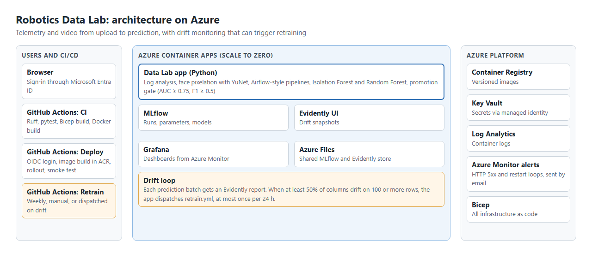
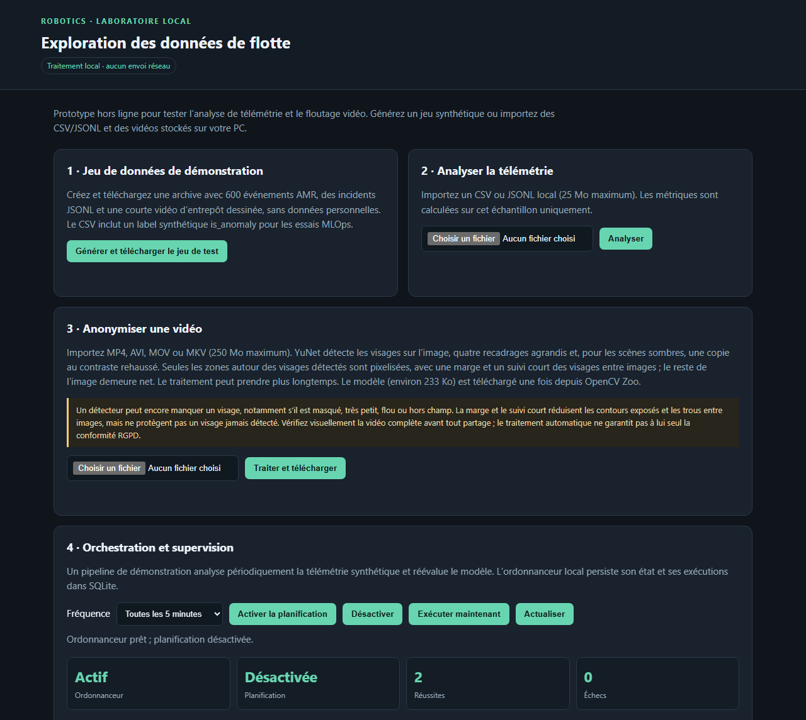

# Azurobotics — Data Lab robotique MLOps sur Microsoft Azure

[](https://github.com/zz75da/azurobotics/actions/workflows/ci.yml)
[](https://github.com/zz75da/azurobotics/actions/workflows/deploy.yml)

Plateforme d'exploration de télémétrie robot, de détection d'anomalies et d'anonymisation vidéo, **déployée sur Azure Container Apps** et décrite entièrement en **Bicep** (Infrastructure as Code). Le dépôt couvre le cycle MLOps de bout en bout : entraînement et promotion de modèles, suivi des expériences dans **MLflow**, détection de dérive avec **Evidently**, supervision **Azure Monitor / Log Analytics** dans **Grafana**, et livraison continue par **GitHub Actions** avec une connexion **OIDC sans secret**.

Toutes les applications Azure sont protégées par **Microsoft Entra ID** (Easy Auth), récupèrent leurs secrets dans **Key Vault** par **identité managée** et descendent à **zéro réplica** quand elles ne servent pas. Le même code tourne aussi entièrement en local sur Windows (voir [Mode local](#mode-local-windows)).

> **In English.** An end-to-end MLOps project on Azure: predictive maintenance on telemetry, face anonymisation for video, experiment tracking with MLflow, drift monitoring with Evidently and automated retraining. It runs on Azure Container Apps behind Microsoft Entra ID, is defined in Bicep and is deployed by GitHub Actions with OIDC. On the public AI4I 2020 dataset, feature engineering raised the held-out F1 from 0.52 to 0.88.



## Problème métier et résultats

Un arrêt machine non planifié coûte plus cher qu'une intervention préparée. L'objectif est de signaler les cycles à risque à partir des capteurs, avec assez de précision pour que les alertes restent crédibles. Les pannes sont rares : 3,39 % des 10 000 lignes d'[AI4I 2020](https://archive.ics.uci.edu/dataset/601) (UCI, CC BY 4.0). Un modèle qui répond toujours « pas de panne » atteint donc 96,6 % d'accuracy sans rien détecter. C'est pourquoi le projet suit le F1, la précision et le rappel, et non l'accuracy.

Résultats sur le jeu de test (25 %, stratifié, jamais utilisé pour choisir la configuration ni le seuil) :

| Random Forest sur AI4I | AUC | F1 | Précision | Rappel |
| --- | --- | --- | --- | --- |
| 4 colonnes d'origine ([balayage](tools/results/ai4i_random_forest_sweep_baseline.json)) | 0,957 | 0,52 | 0,76 | 0,40 |
| 9 colonnes, dont 5 ajoutées ([balayage](tools/results/ai4i_random_forest_sweep.json)) | 0,981 | **0,88** | 0,96 | 0,81 |

Sur 85 pannes du jeu de test, le modèle en détecte 81 % contre 40 % auparavant. Les colonnes ajoutées sont la puissance (couple × vitesse angulaire), l'écart de température process/air, l'usure × couple, la température de l'air et le type de produit. La configuration est retenue par F1 en validation croisée 5 plis sur l'entraînement uniquement, parmi 108 combinaisons.

**À lire avec ces chiffres :** AI4I est un jeu de données *synthétique*, dont les pannes suivent des règles publiées (dissipation thermique, puissance, surcharge). Les nouvelles colonnes se rapprochent de ces règles, ce qui explique l'ampleur du gain. Sur de vraies machines, l'écart serait probablement plus faible.

**Floutage des visages :** sur un proxy WIDER FACE de 4 images sources réservées au test, YuNet (en production) laisse 25,0 % de visages insuffisamment couverts à 90 % de couverture, et la meilleure configuration expérimentale SCRFD 2,8 %, au prix d'environ 47 % de surface masquée à tort et de 100 % de faux masques. Cet échantillon est trop petit pour conclure, et les poids SCRFD sont réservés à la recherche non commerciale : ils ne sont pas en production. Détails dans [docs/face-blur-experiments.md](docs/face-blur-experiments.md).



---

## Sommaire

1. [Architecture Azure](#architecture-azure)
2. [Services Azure utilisés](#services-azure-utilisés)
3. [Sécurité et identité](#sécurité-et-identité)
4. [Déploiement de l'infrastructure (Bicep)](#déploiement-de-linfrastructure-bicep)
5. [CI/CD avec GitHub Actions](#cicd-avec-github-actions)
6. [MLOps sur Azure](#mlops-sur-azure)
7. [Observabilité sur Azure](#observabilité-sur-azure)
8. [Coûts et limites de l'environnement Azure](#coûts-et-limites-de-lenvironnement-azure)
9. [Fonctionnalités de l'application](#fonctionnalités-de-lapplication)
10. [Mode local (Windows)](#mode-local-windows)
11. [Structure du dépôt](#structure-du-dépôt)
12. [Tests](#tests)
13. [Architecture cible pour plusieurs To/jour](#architecture-cible-pour-plusieurs-tojour)

---

## Architecture Azure

```text
                         GitHub Actions (OIDC → Entra ID, aucun secret stocké)
                         │  tests → az acr build → az containerapp update → smoke test
                         ▼
┌──────────────────────── Groupe de ressources (francecentral) ───────────────────────┐
│                                                                                      │
│  Azure Container Registry ──(AcrPull, identité managée)──┐                           │
│                                                          ▼                           │
│  ┌───────────────── Container Apps Environment ─────────────────────────────┐        │
│  │                                                                          │        │
│  │  ca-…  Application robotics (app.py)   ◄── Entra ID Easy Auth (HTTPS)    │        │
│  │        1 vCPU / 2 Gio, 0→1 réplica, sonde /api/health                    │        │
│  │            │ MLFLOW_TRACKING_URI / EVIDENTLY_WORKSPACE                   │        │
│  │            ▼                                                             │        │
│  │  ┌──── Azure Files (partage « mlflow », 5 Gio) ────┐                     │        │
│  │  │  /mnt/mlflow/mlruns      /mnt/mlflow/evidently  │                     │        │
│  │  └─────────▲───────────────────────▲───────────────┘                     │        │
│  │            │                       │                                     │        │
│  │  MLflow server (Entra ID)   Evidently UI (Entra ID)                      │        │
│  │                                                                          │        │
│  │  Grafana (Entra ID) ── identité managée ──► Azure Monitor + Log Analytics│        │
│  └──────────────────────────────────────────────────────────────────────────┘        │
│                                                                                      │
│  Key Vault (RBAC) : entra-client-secret, mot de passe admin Grafana                  │
│  Log Analytics : journaux console/système des Container Apps                         │
└──────────────────────────────────────────────────────────────────────────────────────┘
```

Quatre Container Apps partagent un même environnement :

| Container App | Image | Rôle | Fichier Bicep |
| --- | --- | --- | --- |
| Application robotics | `robotics-demo:<sha>` | UI web, API, pipelines, entraînement et prédiction | `infra/main.bicep` + `infra/modules/container-app.bicep` |
| MLflow | `mlflow-server:latest` | Suivi des expériences et des modèles (store fichier sur Azure Files) | `infra/mlflow.bicep` |
| Evidently UI | `robotics-demo:<sha>` (commande `evidently ui`) | Consultation des rapports de dérive | `infra/evidently.bicep` |
| Grafana | `grafana-robotics:latest` | Dashboard « Robotics on Azure (Container Apps) » sur Azure Monitor | `infra/grafana.bicep` |

L'application et MLflow montent le **même partage Azure Files** au même chemin (`/mnt/mlflow`), ce qui permet aux URI d'artefacts MLflow de se résoudre dans les deux conteneurs. Evidently UI réutilise ce partage, l'identité et le stockage d'environnement de MLflow, sans nouveau compte de stockage ni nouvelle attribution de rôle.

## Services Azure utilisés

| Service | Usage dans le projet |
| --- | --- |
| **Azure Container Apps** | Hébergement serverless des 4 applications, révisions uniques, mise à l'échelle 0→1 |
| **Azure Container Registry** | Build des images directement dans Azure (`az acr build`), tirées par identité managée |
| **Azure Files** (Storage Account) | Volume persistant partagé MLflow + snapshots Evidently |
| **Azure Key Vault** | Secret client Entra et mot de passe admin Grafana, autorisation RBAC, soft-delete 7 jours |
| **Microsoft Entra ID** | Authentification intégrée (Easy Auth) devant chaque application ; fédération OIDC pour GitHub Actions |
| **Identités managées** | Système pour l'application, utilisateur pour MLflow, Evidently et Grafana (aucune clé dans le code) |
| **Log Analytics** | Collecte des journaux des Container Apps, requêtée depuis Grafana |
| **Azure Monitor** | Métriques plateforme (requêtes, réplicas, CPU, mémoire) affichées dans Grafana |
| **Azure Verified Modules** | Modules Bicep publics `br/public:avm/...` pour Container Apps, ACR et Log Analytics |

## Sécurité et identité

- **Aucun accès anonyme** : chaque Container App a une configuration `authConfigs` Entra ID avec `unauthenticatedClientAction: RedirectToLoginPage`, HTTPS obligatoire et audience limitée au client Entra. Le smoke test du déploiement vérifie que `/.auth/login/aad` répond bien `302`.
- **Aucun secret dans le dépôt ni dans GitHub** : GitHub Actions s'authentifie auprès d'Azure par **fédération OIDC** (`azure/login@v3` avec `id-token: write`). L'application Entra n'a que le rôle **Contributeur sur le groupe de ressources**.
- **Secrets dans Key Vault, lus par identité managée** : le secret `entra-client-secret` est référencé par URI Key Vault depuis les Container Apps (`identity: 'system'`), jamais copié en clair. Le mot de passe admin Grafana est généré (`newGuid()`) et stocké en secret.
- **Moindre privilège par rôle** : `AcrPull` sur le registre, `Key Vault Secrets User` pour les applications, `Key Vault Secrets Officer` pour le déployeur uniquement, `Monitoring Reader` et `Log Analytics Reader` pour Grafana.
- **Contrôle des hôtes** : `ROBOTICS_DEMO_ALLOWED_HOSTS` est fixé au FQDN exact de l'application ; les requêtes POST d'autres hôtes ou origines sont refusées (aucun joker).
- **Données** : les fichiers et vidéos importés ne sont pas conservés après la requête, les logs n'en contiennent aucun contenu et les rapports Evidently sont écrits avec `include_data=False`.
- **Dépendances** : Dependabot (`.github/dependabot.yml`) et `pip-audit` en CI (à titre indicatif).

## Déploiement de l'infrastructure (Bicep)

L'infrastructure est découpée en un déploiement **au niveau abonnement** (socle) et trois déploiements **au niveau groupe de ressources** (services MLOps).

| Fichier | Portée | Crée |
| --- | --- | --- |
| `infra/main.bicep` | Abonnement | Groupe de ressources, ACR, Log Analytics, Key Vault, environnement Container Apps, application robotics, attributions de rôles |
| `infra/mlflow.bicep` | Groupe de ressources | Compte de stockage + partage Azure Files, stockage d'environnement, identité, Container App MLflow + Easy Auth |
| `infra/grafana.bicep` | Groupe de ressources | Identité, rôles de lecture Monitor/Log Analytics, Container App Grafana + Easy Auth |
| `infra/evidently.bicep` | Groupe de ressources | Container App Evidently UI + Easy Auth (réutilise le partage et l'identité MLflow) |
| `infra/alerts.bicep` | Groupe de ressources | Groupe d'actions et alertes Azure Monitor (erreurs 5xx, redémarrages en boucle) |
| `infra/modules/*.bicep` | Modules | Registre, Log Analytics, Key Vault, environnement, Container App, rôles |

### Prérequis

- Abonnement Azure, Azure CLI avec Bicep (`az bicep install`).
- Une **inscription d'application Entra** (ID client) pour Easy Auth, avec l'URI de redirection `https://<fqdn>/.auth/login/aad/callback` de chaque application.
- Le secret client de cette application déposé dans le Key Vault sous le nom **`entra-client-secret`** (le module Key Vault le référence comme ressource existante).

### Ordre de déploiement

Les noms ci-dessous reprennent `infra/main.parameters.json` (région `francecentral`) ; adaptez-les à votre environnement.

```bash
# 1. Socle : RG, ACR, Log Analytics, Key Vault, environnement, application (image d'attente)
az deployment sub create --location francecentral \
  --template-file infra/main.bicep --parameters infra/main.parameters.json \
  --parameters tenantId=<tenant-id> deployerObjectId=$(az ad signed-in-user show --query id -o tsv)

# 2. Déposer le secret client Entra dans Key Vault
az keyvault secret set --vault-name kv-marso-dev-99ff --name entra-client-secret --value <secret>

# 3. Construire les images dans ACR
az acr build -r crmarsodev99ff -t robotics-demo:latest .
az acr build -r crmarsodev99ff -t mlflow-server:latest mlflow-server
az acr build -r crmarsodev99ff -t grafana-robotics:latest \
  --build-arg SUBSCRIPTION_ID=$(az account show --query id -o tsv) grafana

# 4. MLflow + Azure Files, puis Grafana et Evidently (portée groupe de ressources)
az deployment group create -g rg-marso-dev-99ff --template-file infra/mlflow.bicep --parameters ...
az deployment group create -g rg-marso-dev-99ff --template-file infra/grafana.bicep --parameters ...
az deployment group create -g rg-marso-dev-99ff --template-file infra/evidently.bicep --parameters ...

# 5. Redéployer le socle avec l'image réelle, Entra, l'ingress et le stockage MLflow
az deployment sub create --location francecentral \
  --template-file infra/main.bicep --parameters infra/main.parameters.json \
  --parameters tenantId=<tenant-id> deployerObjectId=<object-id> \
    containerImage=crmarsodev99ff.azurecr.io/robotics-demo:latest \
    entraClientId=<client-id> enableIngress=true mlflowStorageName=<envStorageName>
```

Tant que `containerImage` vaut l'image d'attente Microsoft (`containerapps-helloworld`), l'ingress public, Easy Auth, les secrets et la sonde de santé sont désactivés : le premier déploiement crée le socle sans rien exposer. `envStorageName` est une sortie de `mlflow.bicep`. Les paramètres de chaque template sont déclarés en tête de fichier.

Après la mise en place, les déploiements suivants passent uniquement par GitHub Actions.

## CI/CD avec GitHub Actions

| Workflow | Déclencheur | Étapes |
| --- | --- | --- |
| `ci.yml` | PR et branches hors `main` | Lint Ruff, tests pytest, `pip-audit` (indicatif), compilation des 5 templates Bicep, build des 3 images Docker |
| `deploy.yml` | Push sur `main` ou manuel | Tests → `az acr build` des 3 images → nouvelles révisions Container Apps (environnement GitHub `production`) → attente d'une révision **Healthy** et vérification de la redirection Entra → réentraînement optionnel |
| `retrain.yml` | Lundi 03:00 UTC, manuel, appelé par `deploy.yml` ou déclenché par la dérive | Entraînement **dans le conteneur en production** via `az containerapp exec`, journalisé dans MLflow (hyperparamètres, description, tags `trigger`, `run_id`, `sha`) |

Chaque image applicative est taguée par le SHA du commit et chaque révision reçoit un suffixe `g<run_id>`, ce qui rend chaque déploiement traçable jusqu'au run GitHub.

**Variables du dépôt** (pas de secrets) : `AZURE_CLIENT_ID`, `AZURE_TENANT_ID`, `AZURE_SUBSCRIPTION_ID`, `AZURE_RESOURCE_GROUP`, `AZURE_REGISTRY_NAME`, `AZURE_APP_NAME`, `AZURE_MLFLOW_APP_NAME`, `AZURE_GRAFANA_APP_NAME`, `AZURE_EVIDENTLY_APP_NAME` (facultatif).

## MLOps sur Azure

- **Entraînement** : `POST /api/ml/train` ou le pipeline `train_anomaly_model` ; algorithmes `isolation_forest` (par défaut, non supervisé), `random_forest` (supervisé) ou `auto`. Le score est mesuré sur un découpage test stratifié.
- **Promotion** : un candidat n'est promu que si **ROC AUC ≥ 0,75** et **F1 ≥ 0,5** ; sinon il est rejeté et ne remplace pas le modèle en service. Un seuil de décision optimal en F1 est aussi calculé sur le jeu d'entraînement, à titre informatif.
- **Suivi MLflow** : dès que `MLFLOW_TRACKING_URI` est défini (sur Azure : `file:/mnt/mlflow/mlruns`), chaque entraînement journalise paramètres, métriques, seuils de promotion, statut, tags et une **model card** générée. `MLFLOW_PUBLIC_URL` ajoute un lien vers le run dans l'UI.
- **Réentraînement planifié** : `retrain.yml` réentraîne chaque semaine dans le conteneur de production et journalise le résultat dans MLflow.
- **Dérive** : `POST /api/ml/predict` produit un rapport Evidently écrit dans `EVIDENTLY_WORKSPACE` (`/mnt/mlflow/evidently`), consultable dans l'application Evidently UI derrière Entra. La réponse et la tâche `drift_check` indiquent `drift_share`, `drift_detected` et `retrain` ; `/metrics` expose `robotics_ml_drift_share` et `robotics_ml_retrain_triggers_total`.
- **Réentraînement sur dérive** : si au moins 50 % des colonnes dérivent sur un lot d'au moins 100 lignes, l'application déclenche `retrain.yml` par `workflow_dispatch`, au plus une fois par 24 h (`RETRAIN_COOLDOWN_HOURS`). Désactivé par défaut. Pour l'activer : créer un jeton GitHub à granularité fine limité au dépôt (**Actions : lecture et écriture**), l'enregistrer dans Key Vault sous `github-retrain-token`, puis déployer `infra/main.bicep` avec `retrainRepository=<owner>/<repo>`.
- **Limite actuelle** : `retrain.yml` entraîne sur le jeu synthétique, dans un registre temporaire du conteneur. Le résultat arrive dans MLflow, mais il ne remplace pas le modèle en service et n'utilise pas les données qui ont dérivé. La boucle prouve le déclenchement, pas la correction de la dérive.
- **Données réelles** : `tools/convert_ai4i.py` convertit le jeu public UCI **AI4I 2020** (maintenance prédictive, CC BY 4.0) au format de télémétrie de l'application ; `tools/tune_random_forest.py` en tire un balayage d'hyperparamètres (seuil choisi par validation croisée 5 plis, jeu test jamais utilisé pour la sélection). Le préréglage « Random Forest ajusté (AI4I) » des pipelines reprend la meilleure ligne de `tools/results/ai4i_random_forest_sweep.json`. Les colonnes `air_temp_k`, `temp_delta_k`, `power_w`, `wear_torque` et `type_code` sont facultatives à l'entraînement ; un modèle entraîné avec elles les exige à la prédiction, et les modèles à quatre colonnes continuent de fonctionner.

  ```powershell
  python tools/convert_ai4i.py --output ai4i_telemetry.csv
  python tools/tune_random_forest.py --input ai4i_telemetry.csv --output sweep_results.json
  ```

## Observabilité sur Azure

- **Grafana sur Container Apps** avec la source **Azure Monitor** par identité managée (`azureAuthType: msi`), provisionnée automatiquement. Le dashboard **« Robotics on Azure (Container Apps) »** affiche les requêtes, les réplicas actifs (0 = mis à l'échelle à zéro), le CPU, la mémoire et les journaux applicatifs récents (hors sondes de santé) issus de **Log Analytics**.
- **Logs** : l'application écrit des événements JSON (ID de requête, durée, statut, ID d'exécution) sur la console et dans `logs/app.jsonl` ; Container Apps les envoie à Log Analytics.
- **Santé** : sonde de disponibilité Container Apps sur `/api/health`, vérifiée aussi par le smoke test du déploiement.
- **Alertes Azure Monitor** : `infra/alerts.bicep` prévient par e-mail les propriétaires de l'abonnement en cas de plus de 5 erreurs 5xx en 5 minutes ou d'au moins 3 redémarrages en 15 minutes. Le nombre de réplicas n'est pas surveillé, car zéro réplica est normal ici.

  ```bash
  az deployment group create -g <groupe> --template-file infra/alerts.bicep --parameters containerAppName=<app>
  ```
- **Métriques Prometheus** : `GET /metrics` reste disponible (HTTP, pipelines, modèles), utilisé par la stack Prometheus/Grafana locale.

## Coûts et limites de l'environnement Azure

- Toutes les Container Apps sont en **0→1 réplica** : pas de coût de calcul au repos, mais un **démarrage à froid** de plusieurs secondes au premier appel (le smoke test réessaie en conséquence).
- Partage Azure Files limité à **5 Gio** ; ACR et Log Analytics sont facturés à l'usage.
- **Stockage applicatif éphémère** : SQLite (`data/`) vit dans le conteneur. Le registre local des modèles et l'historique des pipelines sont **perdus à chaque redéploiement ou redémarrage** ; seuls MLflow et les snapshots Evidently, sur Azure Files, persistent. Une exécution interrompue est marquée en échec au redémarrage.
- **Un seul réplica** par conception : l'ordonnanceur et les pipelines s'exécutent dans un seul processus, sans exécution distribuée.
- MLflow utilise un store fichier, adapté à un environnement de démonstration, pas à une équipe nombreuse.
- Pour éviter les coûts, supprimer le groupe de ressources : `az group delete -n <resource-group>`.

---

## Fonctionnalités de l'application

```text
Navigateur (HTML/CSS/JS sans framework)
        │ HTTP (loopback en local, Entra ID sur Azure)
        ▼
Serveur Python standard (app.py)
   ├── CSV / JSONL → KPI en mémoire (robot_data.py)
   ├── Jeu synthétique → ZIP généré à la demande
   ├── Vidéo → OpenCV → MP4 anonymisé (video_privacy.py)
   ├── Ordonnanceur à un processus → SQLite (operations.py)
   ├── Pipelines de tâches type Airflow (pipelines.py)
   ├── MLOps : scikit-learn → modèle versionné → API de prédiction (mlops.py)
   ├── Suivi MLflow (experiment_tracking.py)
   ├── Evidently : rapports de dérive sans conservation des données sources
   └── Logs JSONL + métriques Prometheus (observability.py)
```

Le jeu de démonstration est synthétique : 600 lignes de télémétrie, incidents JSONL, labels d'anomalie artificiels équilibrés à 5 % et une courte scène dessinée sans personne réelle. Les labels servent à tester le câblage, pas à démontrer une qualité sur des robots réels.

### API principales

- `GET /api/health` : disponibilité et état du scheduler.
- `GET /api/operations` : fréquence, prochaine exécution, historique et logs récents.
- `GET /metrics` : métriques Prometheus HTTP et pipeline, avec labels bornés.
- `GET /api/ml/status` : modèle actif, dernières versions et lots prédits.
- `POST /api/ml/train` : entraîne, évalue et promeut ou rejette un candidat.
- `POST /api/ml/predict` : prédit sur un CSV avec `duration_ms`, `battery_pct`, `x_m`, `y_m` et crée un rapport Evidently.
- `GET /api/pipelines`, `POST /api/pipelines/<nom>/run`, `GET /api/pipelines/runs[/<id>]` : pipelines et historique par tâche.

### Orchestration et pipelines

La section « Orchestration et supervision » lance le pipeline synthétique à la demande ou le planifie toutes les 1, 5, 15 ou 60 minutes (API : 60 s à 24 h). Un lancement concurrent du même job est refusé ; une exécution restée `running` après une interruption est marquée en échec.

Le panneau « 6 · Pipelines » exécute de petits graphes de tâches qui réutilisent le code existant :

| Pipeline | Tâches |
| --- | --- |
| `train_anomaly_model` | `validate_data` → `train` (suivi MLflow) → `evaluate` → `promote` |
| `score_and_drift` | `validate_data` → `predict` → `drift_check` |
| `analyze_logs` | `parse` → `incidents_kpis` |

Corps de `POST /api/pipelines/<nom>/run` : `{params, filename?, content?}` (CSV/JSONL ≤ 25 Mo, paramètres validés par liste blanche). Une seule exécution à la fois (`409` sinon), délai maximal de 30 min. Si une tâche échoue, ses descendantes passent `skipped` (`upstream_failed`). Métriques : `robotics_pipeline_runs_total{pipeline,status}`, `robotics_pipeline_run_duration_seconds`, `robotics_pipeline_active`. Les 50 dernières exécutions sont gardées en mémoire, les 200 dernières dans `data/mlops.sqlite3`.

L'ordonnanceur maison est volontairement limité à un processus : ni retry configurable, ni exécution distribuée, ni dépendances inter-jobs, ni alerte externe.

### Formats et traitement

- CSV avec colonnes recommandées `timestamp`, `robot_id`, `event`, `duration_ms`, `battery_pct`, `x_m`, `y_m` (plus `is_anomaly` pour l'entraînement).
- JSONL avec un objet JSON par ligne ; maximum 25 Mo et 200 000 lignes par analyse.
- Vidéo MP4, AVI, MOV ou MKV, maximum 250 Mo ; résultat en MP4 à télécharger.
- Profil qualité : horodatages, identifiants robot et types d'événement manquants, batteries hors 0–100, durées négatives. Ce sont des alertes descriptives, sans correction automatique.

### Anonymisation vidéo

Pixelisation des visages détectés par **YuNet** (OpenCV Zoo, licence MIT, ~233 Ko, vérifié par SHA-256 et mis en cache dans `data/models/`) : seuil de confiance 0,35, quatre recadrages agrandis par image, passe CLAHE sur les images sombres, marges autour des visages, suivi court (0,25 s) pour combler les détections manquées, mosaïque plafonnée à 8 blocs par côté.

**Confidentialité :** la détection peut manquer des visages masqués, minuscules, flous ou de profil. L'anonymisation automatique seule ne garantit pas la conformité RGPD : inspecter la vidéo image par image et conserver l'original dans un espace restreint. Les vidéos ne sont jamais envoyées vers un service tiers.

Un banc d'essai reproductible sur un proxy **WIDER FACE** compare YuNet et SCRFD, les seuils, le tuilage et le suivi, avec journalisation MLflow (`tools/face_blur_benchmark.py`, résultats dans `tools/results/`). Méthode, résultats et limites : [docs/face-blur-experiments.md](docs/face-blur-experiments.md). La configuration SCRFD retenue est une comparaison de recherche (poids InsightFace non commerciaux), pas une recommandation de production ; la production reste sur YuNet.

Références :

- Bajpai, R. & Aravamuthan, B. (2026). [SecurePose: Automated face blurring and human movement kinematics extraction from videos recorded in clinical settings](https://doi.org/10.1038/s41598-026-50340-5), *Scientific Reports*, 16.
- Wu, W., Peng, H. & Yu, S. (2023). [YuNet: A Tiny Millisecond-level Face Detector](https://doi.org/10.1007/s11633-023-1423-y), *Machine Intelligence Research*, 20, 656–665.
- [OpenCV Zoo — YuNet](https://github.com/opencv/opencv_zoo/tree/main/models/face_detection_yunet).

---

## Mode local (Windows)

Le même code fonctionne sans compte cloud : SQLite, artefacts de modèles et rapports Evidently restent locaux, et l'interface n'écoute que sur `127.0.0.1`. Python 3.10 à 3.12 64 bits est recommandé.

```powershell
py -3.12 -m venv .venv
.\.venv\Scripts\Activate.ps1
python -m pip install --upgrade pip
python -m pip install -r requirements.txt
python app.py
```

Ouvrir <http://127.0.0.1:8765> (port modifiable avec `ROBOTICS_DEMO_PORT`). Le bouton « Générer et télécharger le jeu de test » produit à la demande un ZIP avec le CSV, le JSONL, une vidéo AVI et un descriptif.

### Stack locale avec Docker Compose

Équivalent local de l'environnement Azure, avec Prometheus à la place d'Azure Monitor :

```powershell
docker compose up --build -d
docker compose ps
```

- Application : <http://127.0.0.1:8765>
- Grafana (`admin` / `admin`, à changer à la première connexion) : <http://127.0.0.1:3000>
- Prometheus : <http://127.0.0.1:9090>
- Evidently : <http://127.0.0.1:8000>

Le dashboard **Robotics MLOps**, sa source Prometheus et trois règles d'alerte (application indisponible, aucun modèle promu, pipeline en échec récent) sont provisionnés automatiquement ; aucun Alertmanager n'est inclus. Arrêt sans perte des volumes : `docker compose down` (éviter `down -v`). Rétention locale : 500 exécutions et 500 lots de prédiction dans SQLite, 3 modèles promus, 500 rapports Evidently, logs en rotation sur 4 × 2 Mio, Prometheus à 7 jours / 512 Mio. Vérifier l'espace Docker avec `docker system df`.

### Télécharger une vidéo par lien direct

`python download_video.py` accepte une URL HTTPS directe vers un fichier vidéo (.mp4, .webm, .mov, .avi, .mkv, .m4v) de 250 Mo maximum et l'enregistre dans `downloads/`. Il ne télécharge pas les pages YouTube et ne contourne pas les restrictions des plateformes. Téléchargez uniquement des fichiers que vous êtes autorisé à obtenir.

## Structure du dépôt

```text
.github/workflows/   ci.yml, deploy.yml, retrain.yml
infra/               main.bicep (abonnement), mlflow/grafana/evidently/alerts.bicep, modules/
mlflow-server/       Image du serveur MLflow pour Container Apps
grafana/             Image Grafana Azure (source Azure Monitor, dashboard Container Apps)
monitoring/          Prometheus, alertes et Grafana pour la stack locale
app.py               Serveur HTTP et API
mlops.py             Entraînement, promotion, prédiction, dérive
retrain_trigger.py   Déclenchement de retrain.yml sur dérive
experiment_tracking.py  Journalisation MLflow et model cards
pipelines.py         Graphes de tâches
operations.py        Ordonnanceur et historique
observability.py     Logs JSON et métriques Prometheus
robot_data.py        Analyse CSV/JSONL et jeu synthétique
video_privacy.py     Anonymisation vidéo (YuNet)
tools/               AI4I, tuning Random Forest, banc d'essai floutage, rejeu MLflow
docs/                Expériences de floutage, images du README
tests/               Tests pytest
```

## Tests

```powershell
python -m pip install -r requirements-dev.txt
pre-commit install
ruff check .
python -m pytest -q
```

Sous Linux, macOS ou Git Bash avec `make` : `make install`, puis `make check`.

Les mêmes tests conditionnent chaque déploiement Azure dans `deploy.yml`.

## Architecture cible pour plusieurs To/jour

Ce prototype n'est **pas** un pipeline de production à plusieurs To/jour. En gardant le même contrat de données, chaque composant peut évoluer séparément, en services managés Azure ou en open source :

| Besoin | Option Azure managée | Option open source |
| --- | --- | --- |
| Ingestion robot → cloud | Azure IoT Hub / Event Hubs | MQTT (EMQX, Mosquitto) + Kafka/Redpanda |
| Données brutes immuables | ADLS Gen2 + Delta Lake | MinIO + Apache Iceberg |
| Traitements batch/stream | Azure Databricks, Stream Analytics | Spark, Flink |
| Orchestration | Azure Data Factory, Databricks Workflows | Dagster, Airflow |
| Entraînement et registre de modèles | Azure Machine Learning (MLflow managé) | MLflow sur base SQL |
| SQL et séries temporelles | Azure Data Explorer, PostgreSQL Flexible Server | Trino + TimescaleDB |
| Observabilité | Azure Monitor, Application Insights, Managed Grafana | OpenTelemetry + Prometheus + Grafana |
| Anonymisation vidéo | Conteneurs GPU / AKS avec file de quarantaine | FFmpeg + détecteur validé localement |

Le débit, la rétention, le nombre de sites, la connectivité, la politique de conservation vidéo et les exigences RGPD déterminent le dimensionnement. Ne pas promettre une capacité chiffrée avant un test de charge représentatif ; garder les vidéos en stockage objet et leurs métadonnées en SQL.

### Pratiques retenues et sources consultées (23 octobre 2026)

- **Trois signaux complémentaires** (logs, métriques, traces) : [OpenTelemetry — Signals](https://opentelemetry.io/docs/concepts/signals/), [Logs Data Model](https://opentelemetry.io/docs/specs/otel/logs/data-model/). Le prototype a les logs et les métriques ; les traces distribuées ne se justifient pas pour un service unique.
- **Mesures adaptées aux jobs batch** (dernière réussite, durée, volumes, heartbeat de bout en bout) : [Prometheus — Instrumentation](https://prometheus.io/docs/practices/instrumentation/), [Metric naming](https://prometheus.io/docs/practices/naming/).
- **Déclenchement sur la fraîcheur des données** plutôt que sur l'horloge seule : [Dagster — Schedules](https://docs.dagster.io/guides/automate/schedules), [Asset freshness policies](https://docs.dagster.io/guides/observe/asset-freshness-policies), [Airflow — Asset-aware scheduling](https://airflow.apache.org/docs/apache-airflow/stable/authoring-and-scheduling/asset-scheduling.html).
- **Qualité mesurable et tests préventifs** : [dbt Labs (25 août 2025) — Observability for modern data teams](https://www.getdbt.com/blog/data-observability) (source fournisseur).
- **Travaux récents (préprints, non évalués par les pairs au 23 octobre 2026)** : Jung et al., « Implementation Guidelines for Data Quality Metrics », [arXiv:2610.10919](https://arxiv.org/abs/2610.10919) (soumis à EDBT 2027) ; « TSGuard », [arXiv:2610.03147](https://arxiv.org/abs/2610.03147) (CIKM '26 à venir).

Ces sources étayent des motifs d'ingénierie, pas un dimensionnement. Pour des données robot réelles, définir avec les équipes des contrôles de plausibilité physique (batterie, vitesses, cadence, horodatage, synchronisation) et faire valider leurs seuils avant toute correction automatique.
